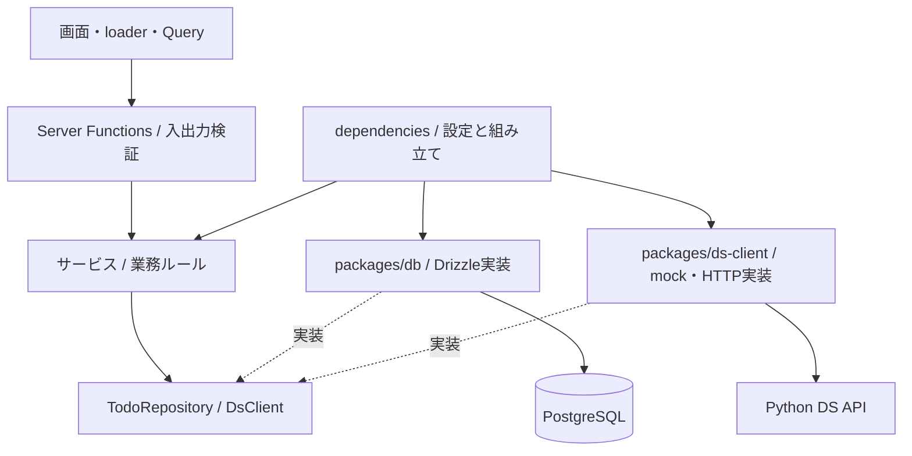

# バックエンドの責務と変更の入口

このアプリではTanStack Startが画面だけでなくTODOの業務処理とDBを所有する。そのため、`sdd-backend-template` の `routers → services → crud / apis` と同じ依存の向きを採用する。フレームワークに合わせて名前と配置を変えている。

| 配置                                         | 責務                                                     | 置かない処理                               |
| -------------------------------------------- | -------------------------------------------------------- | ------------------------------------------ |
| `apps/web/src/routes`, `features`, `queries` | URL、表示、フォーム、Query、SDKの会話状態                | SQL、DSへのHTTP、接続設定                  |
| `apps/web/src/contracts`                     | 公開DTO、アプリ入力、公開エラー                          | Drizzleの行型、接続、内部例外              |
| `apps/web/src/server/functions`              | リクエスト検証、サービス呼び出し、公開結果への変換       | SQL、業務ルール、外部APIへのfetch          |
| `apps/web/src/server/services`               | ユースケース、未検出判定、候補取得、チャットへの入力整形 | React、Router、Drizzle、環境変数、HTTP通信 |
| `apps/web/src/server/dependencies`           | 環境変数と具体実装の組み立て                             | 画面や業務ルール                           |
| `packages/db`                                | テーブル、マイグレーション、repository実装               | DSの呼び出し、画面DTOの判断                |
| `packages/ds-client`                         | DsClient、mock / HTTP、タイムアウト、応答検証            | TODO保存、画面の状態                       |
| `packages/ds-contract`                       | OpenAPI、生成型、AG-UI対応範囲、共通fixture              | DB、TanStack固有のUI型                     |
| `packages/chat-adapter`                      | AG-UIイベント順序検証、SSE、SDKとの差分                  | TODO業務ルール                             |
| `services/ds-api/src/logic`                  | DSが差し替えるPython処理                                 | アプリDBや画面の型                         |

## 依存を組み立てる場所

サービスは必要な操作だけを持つportを受け取り、DBや通信の具体実装を自分で生成しない。composition rootである `server/dependencies` が設定を読み、PostgreSQL repositoryと、DS_MODEに対応するクライアントを注入する。DIコンテナや汎用CRUD基底クラスは導入しない。

サービスの単体テストではportを差し替える。repositoryは実PostgreSQLで検証し、DSはmockと実Python HTTPに共通の契約テストを適用する。公開DTOの日時はISO文字列とし、DBのDateやORM型をブラウザとの契約にしない。

サーバー専用の組み立ては `.server.ts` に置き、Server Functionsのhandler内から読み込む。Startのビルドによるサーバー実装除去とimport protectionを使う。`npm run lint` は型チェックと依存境界チェックを行う。`npm run verify:type-check` は意図的な型エラーを一時配置し、アプリ・共有パッケージ・テストを検出範囲に含むことを確認する。

## トランザクションとエラー

現在のTODO更新は一操作・一SQLで原子的に処理する。候補取得はDBを変更せず、採用時に通常のTODO追加サービスを呼ぶ。外部APIの応答待ちにDBトランザクションを保持しない。

複数のDB更新をまとめるユースケースを追加するときは、そのサービスの境界でtransactionを開始し、同じtransactionを使うrepositoryを渡す。各repositoryが勝手にcommitする方式にはしない。必要になるまではtransaction管理の汎用層を追加しない。

入力不備、未検出、DS障害を公開エラーへ分類し、SQLや接続文字列、内部例外を返さない。チャット開始後のエラーはRUN_ERROR、終端のない切断は失敗として扱う。停止は成功と区別する。HTTPが失敗してもmockへ自動フォールバックしない。

## 変更の例

- TODOに項目を追加する: DB schema → `npm run db:generate` → migration確認 → 公開DTO・サービス → フォームと表示 → テスト。
- TODOに業務ルールを追加する: servicesと単体テスト。SQLや画面に同じルールを複製しない。
- Pythonの候補ロジックを変える: `services/ds-api/src/logic` とPythonテスト。入出力を維持するなら画面やDBを変更しない。
- DS契約を変える: Python schema → OpenAPIとTypeScript再生成 → 実行時スキーマ・共通fixture → mock / HTTP共通契約テスト → 利用箇所。
- 認証を追加する: Server Functionsの共通境界で利用者を確認し、サービスへ必要な利用者情報だけ渡す。権限による対象制限はサービスとrepositoryにも反映する。

チャットが不要な案件ではchat route・feature・function・service、chat-adapter、DsClientのstreamChatと対応Python endpoint、AI SDKの依存を削除できる。TODO CRUDとJSON候補提案はチャットに依存しない。

## レポートの読み取りとDS連携

`/reports`のサービスはReportRepositoryとDsClient.createWorkReportを受け取る。ReportRepositoryは単一SQLで件数と未完了TODO最大3件の同一時点のスナップショットを返す。サービスは読み取り完了後に必要な項目だけをDSへ渡し、DSの待機中はDBトランザクションを保持しない。集計やデータの所有はStart、要約と次の一歩の生成はDSとする。

レポートはJSON応答で、AG-UIやチャットに依存しない。Queryがキャッシュ・再取得、Suspenseが初回待機、局所的なエラー境界が初回失敗を扱う。詳細とコードは[pending.md](pending.md)を参照。
