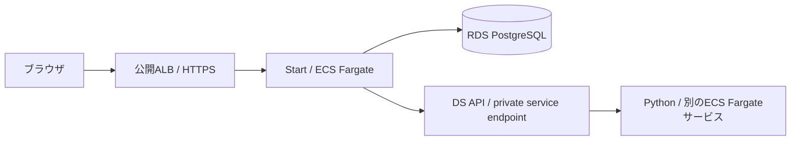
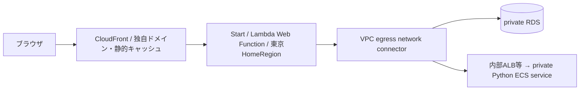

# AWS・オンプレでの配置案

2026-10-18時点の公式情報に基づく比較材料。まずは **StartとPythonを別々のECSサービスに置く案** を基準にし、低頻度・変動アクセスなら **StartだけLambda Web Functionsへ置く案** を比較する。GPU・長時間処理・既存設備に応じてDSの配置を交換する。

このリポジトリではNodeサーバーとPythonをDockerで動かし、HTTP・JSON・SSEの契約をローカルとComposeで検証済み。以下のAWS構成は設計案であり、AWSへのデプロイ、負荷・実課金の測定、IaCの実装は行っていない。現行アプリは認証を持たないローカルデモなので、公開前に認証と権限を追加する。

## 要件から選ぶ構成

| 案                       | Start                          | Python / DS                                               | DB                            | 向く条件・費用の性格                                                     |
| ------------------------ | ------------------------------ | --------------------------------------------------------- | ----------------------------- | ------------------------------------------------------------------------ |
| A 小規模PoC              | EC2上のDocker                  | 同じホストの別コンテナ                                    | 同ホストPostgreSQL、またはRDS | 少ない構成で開始。常時VM費用と自主管理。単一ホストは冗長化されない       |
| B AWSの基準案            | ECS Fargate                    | 独立したECS Fargateサービス                               | RDS PostgreSQL                | CPU/RAM、スケール、リリースを別々に設定。最小稼働タスク数に応じた常設費  |
| C 変動アクセス           | Lambda Web Functions           | ECS Fargate、またはGPU用ECS                               | RDS PostgreSQL                | Startはリクエスト・active CPU等の従量課金。常設DSとDBの費用は残る        |
| D GPU・特殊環境          | ECS FargateまたはWeb Functions | ECS on EC2 / ECS Managed InstancesのGPUノード             | RDS PostgreSQL                | CUDA・GPU・大容量RAMをDS側だけに割り当てる。GPU稼働時間が費用を左右      |
| E 長時間・低頻度推論     | ECS FargateまたはWeb Functions | Python窓口＋SageMaker非同期推論、またはBatch / ECS worker | RDS＋結果用S3等               | 待ちを許容してGPU等をゼロ縮退。受付・状態・結果を分ける追加実装が必要    |
| F オンプレ・ハイブリッド | オンプレDocker、またはAWS      | オンプレのCPU/GPUマシン                                   | オンプレPostgreSQL、またはRDS | 既存設備・閉域・データ配置に合わせる。設備と運用費、専用線/VPN費を含める |

A・B・D・Fは標準HTTPサーバーとコンテナを再利用しやすい案。現行Dockerfileを出発点にできるが、CPUアーキテクチャ、Pythonの依存、GPUランタイム、TLS、ヘルスチェック、永続化・バックアップは対象環境に合わせる。ComposeをECSの本番設定としてそのまま投入する意味ではない。

## B: ECSを基準にする



StartとPythonを別サービス・別タスク定義にする。Pythonだけに重いライブラリやモデルを入れ、必要に応じてCPU・RAM・レプリカ数を増やす。内部接続にはプライベートなサービス発見や内部ALBなどを選ぶ。Compose内の`http://ds-api:8000`という名前は、そのままAWS上の接続先になるわけではない。

FargateはLinuxでx86_64 / ARM64に対応し、現在は最大32 vCPU / 244 GBの組み合わせまで選べる。一方GPUは非対応。重いCPU処理の候補にはなるが、ライブラリのGPU要件や大きな共有メモリ等は別途確認する。[Fargateの対応条件](https://docs.aws.amazon.com/AmazonECS/latest/developerguide/fargate-tasks-services.html)

ライブラリ・モデルが大きいと、イメージ取得と起動後のロードが待ち時間になる。CPU・メモリだけでなく、コールド起動とモデル常駐の必要性も測る。Fargateの一時ストレージは既定20 GiB、最大200 GiBで、イメージも消費する。[一時ストレージ](https://docs.aws.amazon.com/AmazonECS/latest/developerguide/fargate-task-storage.html)

常時同期応答するAPIなら、まず必要な最小タスクを稼働させる。ECSの最小数を0にするだけでは、最初のHTTPリクエストを保持して起動完了まで待つ仕組みにはならない。利用がない時間の停止やキュー駆動の起動は、応答要件と一緒に設計する。[ECSの自動スケール](https://docs.aws.amazon.com/AmazonECS/latest/developerguide/service-auto-scaling.html)、[ターゲットがない場合のALB](https://docs.aws.amazon.com/elasticloadbalancing/latest/application/load-balancer-troubleshooting.html)

## C: StartをLambda Web Functionsへ



新しいWeb Functionsは標準のNode HTTPサーバーを実行し、SSR・レスポンスの途中配信を対象にしている。StartはDB・DSへのI/Oが多いため、設計上は候補になる。Node.js 24で動いているこのアプリとの適合性は高そうだが、実環境での検証結果ではない。[Web Functionsの用途と課金モデル](https://docs.aws.amazon.com/lambda/latest/dg/web-functions.html)

確認時点では東京で利用可能、Node.js 24 / Arm64が対象で、Pythonは対象外。StartとPythonを一緒にこのサービスへ載せる案にはしない。[提供開始と対応リージョン](https://aws.amazon.com/jp/blogs/news/announcing-aws-lambda-web-functions-for-fast-consistent-web-app-performance-anywhere/)

| 項目                         | 構成上の意味                                                                                      |
| ---------------------------- | ------------------------------------------------------------------------------------------------- |
| ZIP配置、展開後512 MBまで    | ECS用Dockerイメージをそのままアップロードする方式ではない。Nitroの`.output`をZIPへまとめる        |
| Node用entry file             | 起動アドレスを設定してからNitroを起動する小さなentryが必要                                        |
| `AWS_LAMBDA_HTTP_ENDPOINT`   | AWSが指定するhost:portでlistenする。現行出力のNITRO_HOST / NITRO_PORTへ起動前に対応付ける         |
| 2 GBの実行環境、起動期限10秒 | Startの起動時間・ピークメモリを測る。DSの大きなモデルは別環境に置く                               |
| 同一環境で複数リクエスト     | グローバル変数に利用者やリクエストの状態を保持しない。既存のSSR QueryClientはリクエストごとに作る |

[ZIPとentry](https://docs.aws.amazon.com/lambda/latest/dg/web-functions-code-s3.html)、[ランタイムと待受](https://docs.aws.amazon.com/lambda/latest/dg/web-functions-runtimes.html)

現行のNode出力は`NITRO_HOST/HOST`と`NITRO_PORT/PORT`を参照する。ZIPでは`.output/server`に加え静的ファイルの`.output/public`も含め、指定アドレスを設定した後にサーバーを読み込む。これはコードを確認した上での移植方針であり、デプロイ済みの起動手順ではない。従来のLambda Event Functions＋Web Adapter / Function URLや、Nitroの従来Lambda向けpresetと混同しない。

private RDS・ECSへの接続はVPC egress network connectorを使える。ただし、connector付きrevisionを使えるendpointはHomeRegionのみ。まず東京1リージョンで考え、マルチリージョン配信とprivate DBアクセスを自動的に両立できるとは扱わない。VPC接続後のインターネット向け経路も必要に応じ設計する。[ネットワーク仕様](https://docs.aws.amazon.com/lambda/latest/dg/web-functions-networking.html)

Web Functionが増えてもDBとGPUが無制限に増えるわけではない。現行`pg.Pool(max:10)`は環境ごとに作られるため、環境数が増えるとDB接続も増える。pool上限、endpointのrate limit / maxEnvironments、必要ならRDS Proxyを合わせて検討する。低頻度時はゼロ縮退できるが、コールドスタートは残る。[スケーリング](https://docs.aws.amazon.com/lambda/latest/dg/web-functions-scaling.html)、[RDS Proxy](https://docs.aws.amazon.com/AmazonRDS/latest/UserGuide/rds-proxy.html)

Web Functionsのリクエスト期限は既定30秒、設定可能範囲3〜900秒。SSEもストリーム全体が期限の対象になり、期限切れ時はHTTP 200のまま本文が切れることがある。現在のAG-UI終端検証を維持し、HTTP成功だけで生成成功にしない。[リクエスト期限](https://docs.aws.amazon.com/lambda/latest/dg/web-functions-revisions-timeout.html)

## D・E: DSの重さに合わせて交換する

GPUが必要なら、Python APIをECS on EC2またはECS Managed InstancesのGPUノードへ配置する。Managed InstancesにはNVIDIAドライバー・CUDAを準備したGPUサポートがある。対応インスタンスとリージョン・容量・イメージを確認して選ぶ。StartのTODO処理へCUDA依存を持ち込む必要はない。[Managed InstancesのGPU](https://docs.aws.amazon.com/AmazonECS/latest/developerguide/managed-instances-gpu.html)

モデル配信をSageMakerへ任せるなら、Python APIを窓口として残し、内部でSageMakerを呼ぶ案が扱いやすい。SageMakerは独自の推論API・コンテナ契約を持つため、現行`DS_API_URL`の変更だけで接続できるわけではない。[推論方式](https://docs.aws.amazon.com/sagemaker/latest/dg/deploy-model-options.html)、[コンテナ契約](https://docs.aws.amazon.com/sagemaker/latest/dg/your-algorithms-inference-code.html)

低頻度の重い推論ならSageMaker Asynchronous Inferenceが候補。入力をキューに保持し、最大1 GB・1時間の処理、ゼロ台への縮退を扱う。入力・結果はS3等を使うため、対話チャットのSSEをそのまま置き換える方式ではない。[非同期推論](https://docs.aws.amazon.com/sagemaker/latest/dg/async-inference.html)

real-timeもinference componentでゼロ台にできるが、再稼働に数分かかり、その間の呼び出しはエラーになる。同期APIの即応性と両立する無料の待機機能とは考えない。[real-timeのゼロ縮退](https://docs.aws.amazon.com/sagemaker/latest/dg/endpoint-auto-scaling-zero-instances.html)

推論以外も含む長い前処理・分析ならAWS BatchやSQS＋ECS workerを検討する。GPUジョブも選べる。現行アプリは15秒のDS全体タイムアウトでJSON/SSEを待つ方式なので、長時間処理には`202 + jobId`、永続状態、結果取得、再試行・重複実行対策・中止の契約を追加する。タイムアウト値だけを伸ばしてジョブ基盤の代わりにしない。[BatchのGPU](https://docs.aws.amazon.com/batch/latest/userguide/gpu-jobs.html)

## F: オンプレ・ハイブリッド

Startは標準のNodeサーバー、Pythonは独立HTTPサービスなので、同じ論理構成をオンプレのDocker環境でも採れる。既存GPUマシンだけオンプレに残し、Start・DBをAWSに置く案もある。後者ではVPN / Direct Connect等の経路、遅延、帯域、データ持ち出し条件を整理する。ECS Anywhereは選択肢の一つで、Dockerを動かすための必須条件ではない。[AWSと外部設備の接続例](https://aws.amazon.com/blogs/containers/how-to-establish-private-connectivity-with-ecs-anywhere/)

現行Composeはlocalhost向けデモである。本番オンプレではreverse proxyとTLS、認証、秘密情報、バックアップ、監視、モデルやDBの永続領域、更新時の停止・復旧を運用要件に合わせる。オンプレも設備・保守・電力があるため「無料」とは説明しない。

## 金額を説明するための計算例

以下は **バージニア北部（us-east-1）、USD、月730時間、無料枠・割引・税を含めない例**。東京の見積もりではない。性能・必要容量も未測定で、特に小さなtaskやVMのサイズは料金計算のための仮置きである。重いDSモデルがこのサイズで動くという意味ではない。

### 部品ごとの単価と月額

| 部品           | 単価・前提                                                     | 計算例             |
| -------------- | -------------------------------------------------------------- | ------------------ |
| EC2 t3.medium  | Linux、2 vCPU / 4 GiB、$0.0418/時                              | $30.51/月          |
| EC2用gp3       | 30 GiB、$0.08/GiB月                                            | $2.40/月           |
| public IPv4    | 1個、$0.005/時                                                 | $3.65/月           |
| FargateのStart | Linux x86、0.25 vCPU / 0.5 GB                                  | 約$9.01/月         |
| FargateのDS    | Linux x86、1 vCPU / 2 GB                                       | 約$36.04/月        |
| ALB基本料金    | $0.0225/時                                                     | 約$16.43/月。LCU別 |
| 小規模RDS      | PostgreSQL Single-AZ db.t4g.micro $0.016/時＋gp3 20 GiB×$0.115 | $13.98/月          |

FargateはvCPU秒`$0.000011244`、GB秒`$0.000001235`を使い、`730×3600×(vCPU×CPU単価＋GB×メモリ単価)`で計算した。単位を時・秒で混ぜない。[Fargate料金](https://aws.amazon.com/fargate/pricing/)

[EC2 T3](https://aws.amazon.com/ec2/instance-types/t3/)、[gp3のバージニア単価](https://docs.aws.amazon.com/emr/latest/ManagementGuide/emr-plan-storage-compare-volume-types.html)、[VPC / IPv4料金](https://aws.amazon.com/vpc/pricing/)、[ALB料金](https://aws.amazon.com/elasticloadbalancing/pricing/)、[RDS料金](https://aws.amazon.com/rds/postgresql/pricing/)。RDSの動的表は[料金ページが使う公式JSON](https://b0.p.awsstatic.com/pricing/2.0/meteredUnitMaps/rds/USD/current/rds-postgresql-ondemand.json)でSingle-AZの該当型とgp3を確認した。

- 小さなEC2一台へStart・軽いDS・DBを同居する例: **約$36.56/月**。上のVM・EBS・IPv4のみ。DB保守・バックアップ・単一障害点を自分で引き受ける。
- Fargate二サービス＋ALB基本＋上のRDS: **約$75.46/月の部品小計**。冗長化した本番環境の総額ではない。
- GPU: 選んだGPUインスタンス単価×稼働時間を別に加える。モデル、メモリ、同時実行、起動待ちが未定なので、ここでは金額を確定しない。

### Web Functionsは「Startだけ」の費用を比較する

バージニアのArm単価はリクエスト`$0.30/100万件`、active CPU`$0.0000276944/vCPU秒`、消費メモリ`$0.0000036667/GB秒`。環境の寿命中はリクエスト間のメモリも課金される。DS応答を3秒待つことと、3秒CPUを使うことは分けて測る。[Web Functions料金](https://aws.amazon.com/lambda/pricing/)

仮に月10万リクエスト、1件あたりCPU 40ms、消費メモリ0.5 GB、環境数を合算した稼働時間730時間なら:

```text
リクエスト = 100,000 / 1,000,000 × 0.30                    = $0.0300
CPU        = 100,000 × 0.040 × 0.0000276944               = $0.1108
メモリ     = 0.5 × 730 × 3600 × 0.0000036667              = $4.8180
Startの小計                                                   約$4.96/月
```

0.5 GBは実測値ではない。730環境時間も、AWSが必ず1環境を保つという保証ではない。実際は複数環境の消費メモリと存在時間を積算する。

上のDSとDBを常設するなら、`4.96＋36.04＋13.98 = 約$54.98/月`に接続経路等が加わる。DSへ内部ALBを置く例では、さらに基本料金約$16.43/月を加え **約$71.40/月の部品小計**となる。外側のCloudFront等は別。Webへ移せば一式が数ドルになる、という試算ではない。

### 小計に入れていない費用

NAT Gateway一台を同地域で常設する例は約$32.85/月に処理GB単価とpublic IPv4費が加わる。public ALBのIPv4が2個なら約$7.30/月、NAT用IPv4が1個なら約$3.65/月。上記Fargate小計にこれらを置く設計なら、約$119.26/月にLCU・通信等がさらに加わる。AZごとのNAT、task数、接続方式で変わる。[NAT・IPv4料金](https://aws.amazon.com/vpc/pricing/)

ほかにCloudFront、ALBのLCU、ECR、CloudWatch、S3、バックアップ、Secrets Manager、DNS、AZ間通信や転送を足す。VPC endpointsを使っても、その時間・データ処理料金との比較が必要。RDSをMulti-AZにしたり、Start/DSを各2タスクにしたりすれば別の金額になる。T系のCPUクレジット超過も確認する。

料金例の用途は、常設DS・DB・ネットワークが支配的か、Startの従量課金が効くかを見分けること。採用時は東京と実トラフィックで[Pricing Calculator](https://calculator.aws/)を作り直す。持続的にCPUを使う場合はFargate/EC2の方が有利な可能性があり、Web Functionsが常に最安とは扱わない。

## FastAPIへ全機能を置く案との比較材料

| 変更したいこと                                         | この責務分離での変更範囲                                                    |
| ------------------------------------------------------ | --------------------------------------------------------------------------- |
| Python依存を大きくする、PythonのバージョンやOSを変える | DS側のproject / image / test。Startの業務DB・画面は契約が同じなら変更しない |
| DSだけGPU・大容量RAMへ移す                             | DS配置とクライアント接続設定。SageMaker等の別契約なら専用adapterも追加      |
| Webだけアクセス急増に合わせる                          | Startのサービス/endpointをスケール。DB・DSの保護上限も併せて設定            |
| 画面・TODOを変更する                                   | Startをリリース。モデルのロードやDSの配備を毎回巻き込まない                 |
| オンプレへ持っていく                                   | 標準Node/Pythonコンテナと接続設定を出発点にする                             |

FastAPI側へ業務機能をまとめる案でも、APIを分割し、CPU/GPUワーカーを独立させれば同じ配置の自由度を実現できる。差はフレームワークの独占機能ではなく、最初から分けた契約・所有権・リリース単位にある。この案にもNodeとPythonの2系統、ネットワーク障害、分散トランザクションを避ける設計、ログの相関という負担はある。業務ロジックも大半がPythonで、単一サービスが適切な案件ならFastAPI集約案にも合理性がある。

## 採用前の小さな検証

1. 基準のECSでStartとDSを独立起動し、private DB/API接続、migrationを一度だけ実行する手順、ロールバックを確認する。
2. Web Functions候補はNitroのZIP・待受・起動時間・静的ファイル・東京HomeRegion＋VPC接続を確認する。
3. 各経路でレポートのSSR途中表示、チャットSSEの最初のイベントと継続配信、ブラウザ停止→Python中止、終端なし切断を確認する。
4. ALB・CloudFront・アプリ・DSのtimeoutを揃える。ALBの無通信期限は既定60秒、CloudFrontにも独立した応答待ちがある。必要ならheartbeatとbuffering設定を確認する。[ALB](https://docs.aws.amazon.com/elasticloadbalancing/latest/application/edit-load-balancer-attributes.html)、[CloudFront](https://docs.aws.amazon.com/AmazonCloudFront/latest/DeveloperGuide/DownloadDistValuesOrigin.html)
5. 平均だけでなくp95のTTFB・完了時間、cold start、RSS、DB接続、DS待ち行列、GPU利用率を測る。そのCPU時間・メモリ環境時間・通信量で費用を比較する。

次の検証優先順位は **BのECS基準 → CのStart Web Functions比較 → DS要件が決まったらD/E**。オンプレ必須案件はFを並行して確認する。
