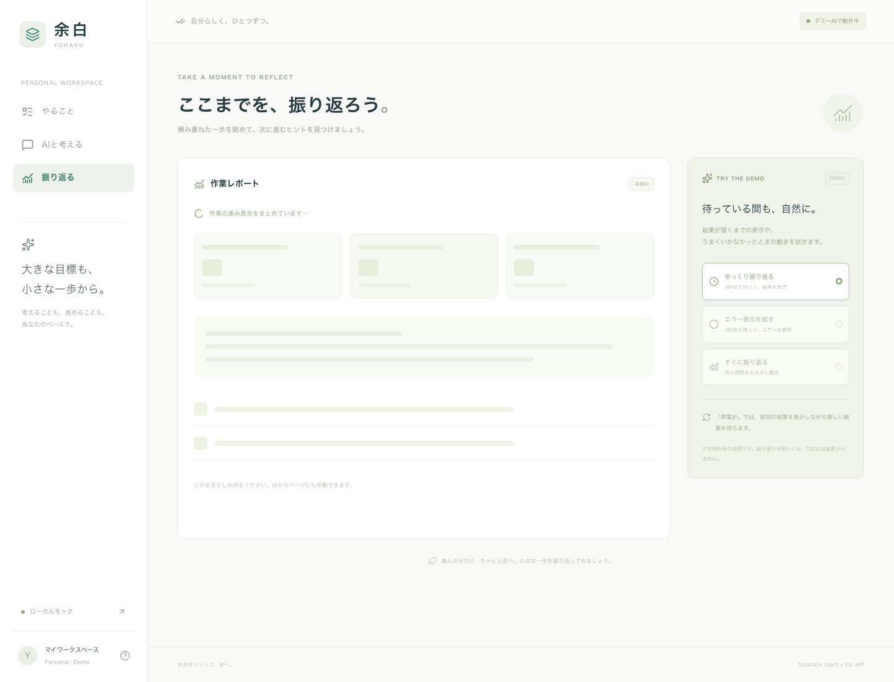
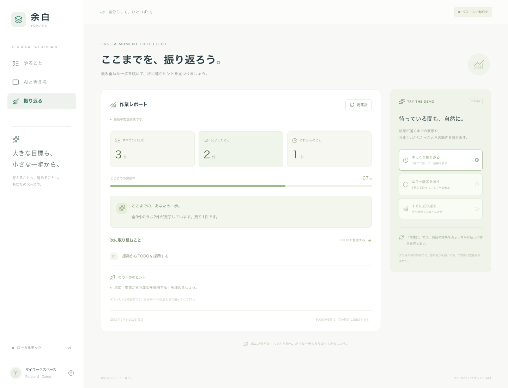
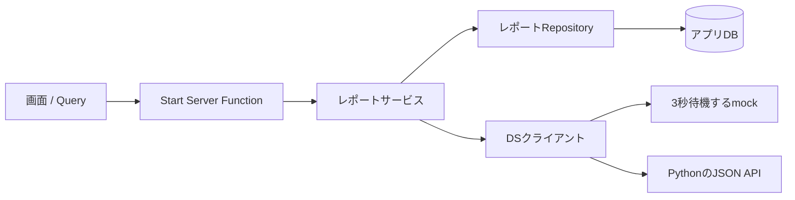

# 作業レポートで見る待機状態

`/reports`は、Startが保存済みTODOを集計し、DSへ必要な情報だけを渡して要約と次の一歩を受け取る画面です。mockでもPython HTTPでも、通常は3秒待ってからJSONを返します。ブラウザのタイマーで結果表示を遅らせる実装ではありません。

## 画面で試す

1. ナビゲーションの「振り返る」を開く。見出しと応答条件を先に表示し、結果欄だけが待機する。
2. 結果が届いたら「再集計」。前回の内容を表示したまま更新中になる。
3. 「エラー表示を試す」で3秒後の失敗と、局所的な「もう一度試す」を確認する。同じ失敗条件の再試行は再び失敗する。
4. 「すぐに振り返る」へ切り替えると、成功する条件で回復する。
5. TODOを追加・変更してから戻ると、無効化されたレポートが新しいデータを取得する。





レポートは読み取り専用です。履歴テーブルや永続ジョブ、チャットの配信は使いません。キャッシュが新鮮な再訪では待機表示を省略できます。初回待機の再確認には再読み込み、同じ条件で結果を残した待機には「再集計」を使います。

## フロントの状態を自前で複製しない

ルートで取得を開始し、完了は待たずに画面を表示します。

```tsx
loader: ({ context, deps }) => {
  void context.queryClient.prefetchQuery(reportQueryOptions(deps.scenario));
},
```

初回にデータがない結果欄はSuspenseのfallbackを表示します。

```tsx
<Suspense fallback={<ReportPending />}>
  <ReportResult scenario={scenario} />
</Suspense>
```

結果がある状態の同じQueryキーの再取得では、前回のdataを表示しながらisFetchingで更新中を示します。

```tsx
const { data, isFetching, error, refetch } = useSuspenseQuery(reportQueryOptions(scenario));
```

これは主要部分の抜粋です。実装には初回エラーを受けるCatchBoundary、再試行のためのQueryErrorResetBoundary、再取得エラーの表示、hydration前の操作防止もあります。レポートの画面・取得コードには、取得用useEffect、loading専用useState、手動のsetLoadingを追加していません。

| 状態                 | 担当                                    |
| -------------------- | --------------------------------------- |
| URLの条件と取得開始  | Routerのsearch / loaderDeps / loader    |
| 初回の結果待ち       | React Suspense                          |
| 取得済み結果と再取得 | Queryのdata / isFetching                |
| 初回の失敗・再試行   | CatchBoundary + QueryErrorResetBoundary |
| 再取得の失敗         | 前回のdataに添えたerror表示             |
| サーバー境界         | Start Server Function                   |

Queryキーへ応答条件を含め、異なる条件のキャッシュを混ぜません。staleTimeは30秒、retryはfalseです。QueryClientは既存のSSRリクエストごとのインスタンスを使います。TODO更新時は一覧に加えreportsのキャッシュも無効化します。

## 案2の責務を維持する



Startは単一のSQL文で全件数・完了件数・未完了TODO上位3件の同じ時点のスナップショットを読みます。全TODOをロードせず、DBの読み取りが終わってからDSへ接続します。DSを待つ間DBトランザクションを保持しません。

DSへ渡すのは件数、未完了のidとtitle最大3件、デモの応答条件です。接続情報、作成日時、完了済みタイトルなどは渡しません。DSは文章の要約・次の一歩だけを返し、画面向けの集計や生成日時はStart側が組み立てます。

`POST /v1/work-report`のOpenAPI・生成型・Zodを用意し、DsClient.createWorkReportをmockとHTTPで実装しています。通常のJSON応答なのでAG-UIには依存しません。Python停止時はHTTPの障害を表示し、勝手にmockへ切り替えません。

| 読むコード         | 配置                                          |
| ------------------ | --------------------------------------------- |
| loaderとURL        | apps/web/src/routes/reports.tsx               |
| Query              | apps/web/src/queries/reports.ts               |
| 結果・待機・エラー | apps/web/src/features/reports/report-page.tsx |
| Server Function    | apps/web/src/server/functions/reports.ts      |
| レポートサービス   | apps/web/src/server/services/reports.ts       |
| DSへのHTTP・mock   | packages/ds-client/src/index.ts               |
| Pythonの処理       | services/ds-api/src/logic/demo.py             |

待機表示の状態管理を簡潔にできる効果はReact・Query・Routerの組み合わせです。StartはSSRと型付きサーバー関数による接続を担当します。Next.jsでもSuspenseやQueryを使えるので、Startだけの優位とは説明しません。

[QueryのSuspense](https://tanstack.com/query/latest/docs/framework/react/guides/suspense) · [Routerの遅延データ取得](https://tanstack.com/router/latest/docs/framework/react/guide/deferred-data-loading)

## 検証で区別すること

見出しだけ先に見えることは、初回HTMLを受け取るブラウザテストに加え、ブラウザ相当User-AgentでSSR応答をチャンク単位に読んで確認します。bot扱いのリクエストは、Startがレンダリング完了を待つ場合があるため分けて扱います。

SSRのSuspense内の初回失敗は、Reactがブラウザで再評価して同じ取得を呼ぶ場合があります。その場合、3秒待ちを2回経てエラーが表示されます。これはQueryのretry:falseによる再試行設定とは別の回復動作です。初回失敗・再取得失敗・応答条件の切り替えを別々に確認します。
